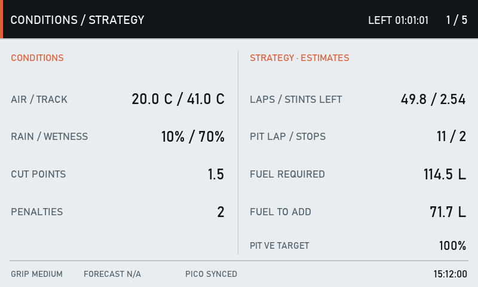
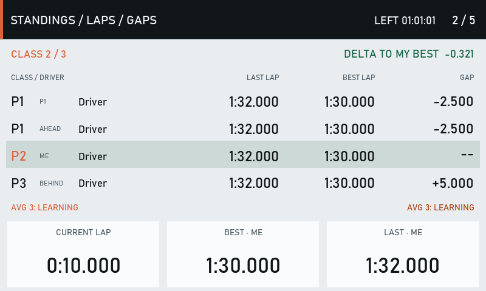
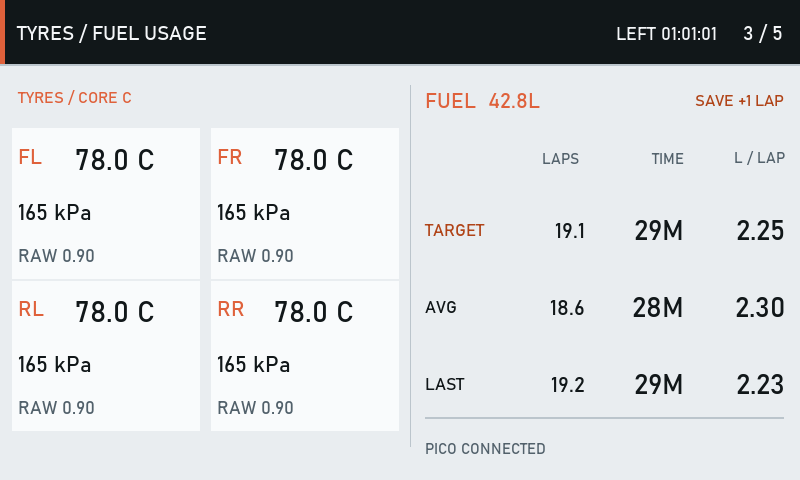
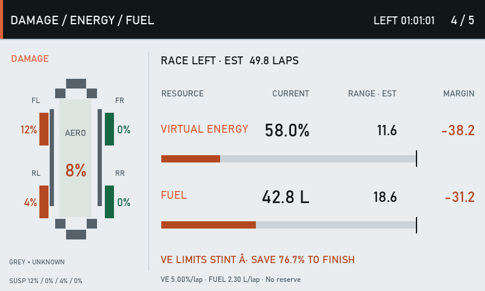
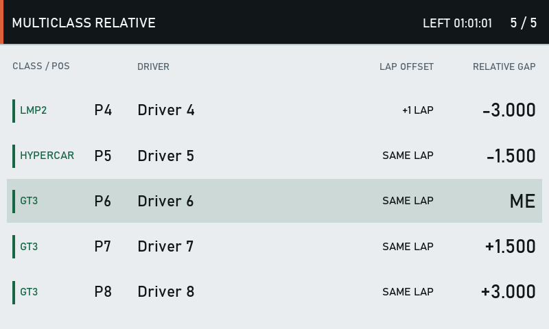
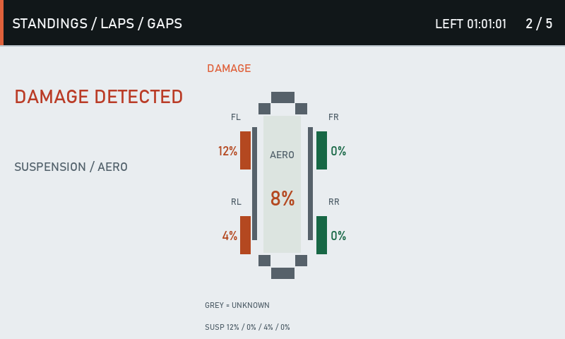

# LMU GT Factory Dashboard

White GT Factory dashboard for Le Mans Ultimate and SimHub, available in **800 × 268** and **800 × 480**.

## Features

- Five pages: conditions/strategy; standings/laps/gaps; tyres/fuel usage; damage/energy/fuel; five-car multiclass relative.
- Three-lap pace comparison: shows who you are catching ahead and who is catching you from behind, with the average advantage in seconds per lap.
- Five-second damage overlay on every page, with a car diagram, aero damage and suspension percentages beside each wheel. Further damage restarts the timer.
- Session time remaining and pit/limiter overlay across all pages.

## Setup

1. Install SimHub and enable its Le Mans Ultimate support.
2. Import the `.simhubdash` from the matching resolution folder under `dashboards/`.
3. Install and enable the NeoRed LMU plugin for suspension/aero damage telemetry. The plugin is not bundled here.
4. Start LMU and enter the car. Configure page navigation through SimHub controls.

This repository distributes SimHub dashboards only. No bridge EXE or Pico firmware is included. The dashboards use native SimHub and NeoRed plugin data when companion data is unavailable. Some telemetry and Pico-specific selections may display N/A. Optional companion integration remains supported by the formulas if separately configured.

The pace comparison needs three newly observed completed laps after startup/session reset. Pit-contaminated or missed-lap sequences reset the average. Keep the dashboard running to collect lap history.

## Screenshots

Screenshots use sample data, not live driving telemetry.

## Distribution

Release files only. Build folders, logs and development source files are excluded. All rights reserved; no open-source licence is granted by this repository. The SimHub dashboard import packages contain editable dashboard definitions and formulas.

## Versioned releases

Download the matching dashboard from [Releases](https://github.com/salman-m-sulphi/SRT-Dashboard/releases). Each update gets a version tag, download packages and release notes. Earlier releases stay available. Update VERSION and RELEASE_NOTES.md with each dashboard update.
