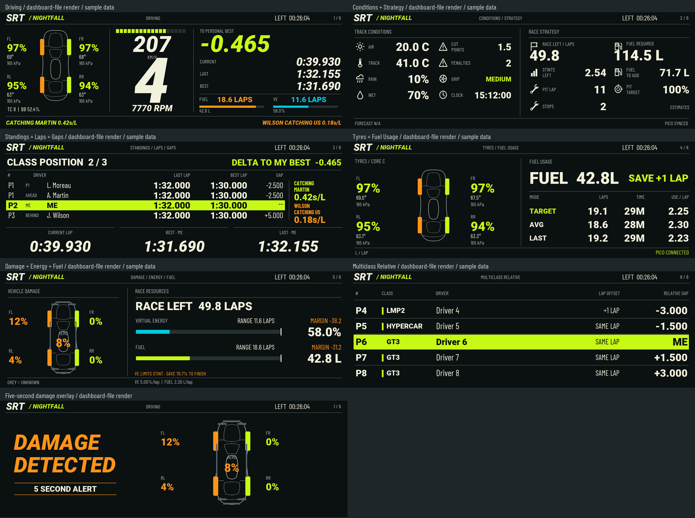
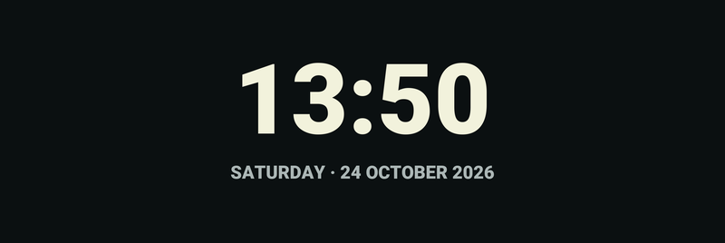
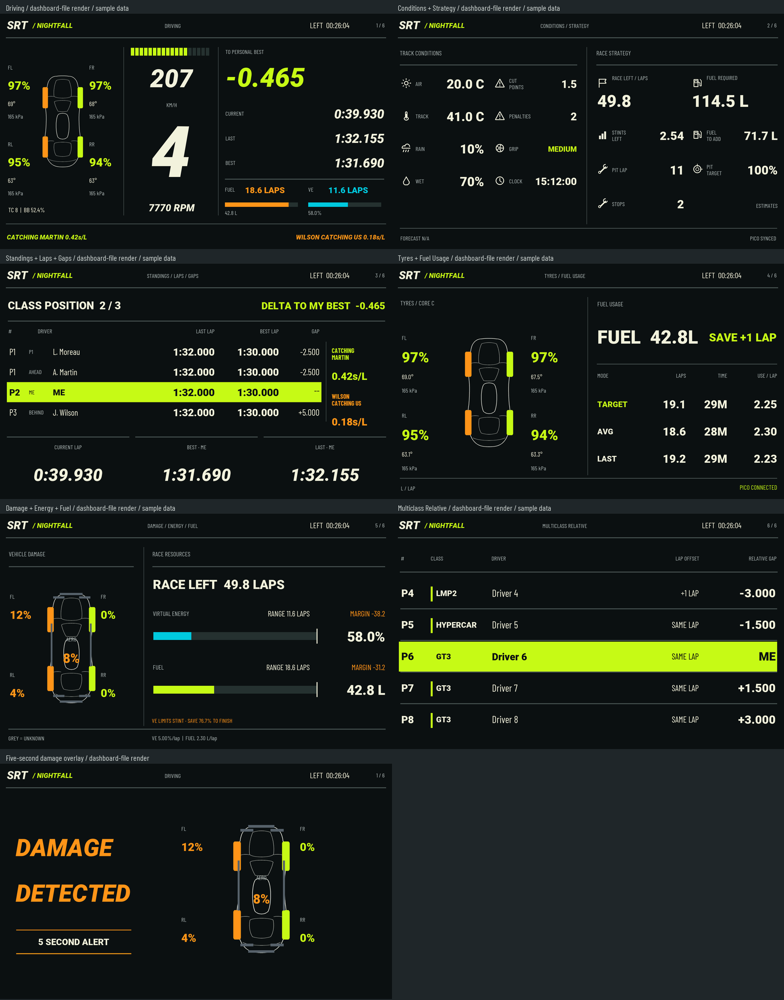

# SRT Dashboard for Le Mans Ultimate

Latest: **SRT Nightfall v1.7 — 800 × 268**, a flat black and lime SimHub dashboard.

[Download v1.7](https://github.com/salman-m-sulphi/SRT-Dashboard/releases/tag/v1.7) or import the `.simhubdash` from the matching folder under `dashboards/nightfall/`.

- Six pages: driving; conditions/strategy; standings/laps/gaps; tyres/fuel usage; damage/energy/fuel; five-car multiclass relative.
- Minimal waiting screen with a centered heavy-bold live PC clock and date.
- Proportional car diagrams, primary tyre percentages, secondary temperature/pressure and compact FIN/LRN status labels.
- Three-lap catching/catching-us comparison and five-second damage alerts, plus session timers and pit/limiter overlays.

Import the attached .simhubdash into SimHub. Enable LMU support and install the NeoRed LMU plugin for suspension/aero damage. Optional companion integration remains supported but is not bundled; some fields may show N/A without its data. Previous dashboard versions remain separate.

Validated with the native SimHub loader and live clock/date formulas; layout, tyre formatting, pace history and damage timing regression checks pass. Live driving verification remains recommended. Race Control warning mirroring is not included in this version.

Dashboard only: no bridge EXE or Pico firmware.

## Preview

Sample telemetry is used in the page previews. The waiting preview is a static capture; the imported clock and date update automatically using the PC's local time.

### 800 × 480 preview

The larger layout passed sample-render and regression checks; its native SimHub load check was unavailable during packaging.

## Earlier versions

The white GT Factory v1.3.1 dashboards remain available in `dashboards/800x268/`, `dashboards/800x480/` and earlier releases. Nightfall v1.7 is currently supplied only at 800 × 268.

## Distribution

SimHub dashboard files only. No bridge EXE or firmware is included. All rights reserved; no open-source licence is granted. Import packages contain editable dashboard definitions and formulas.
