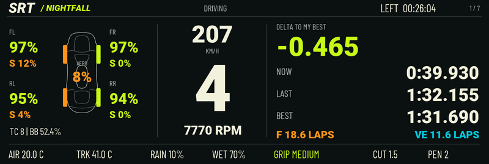
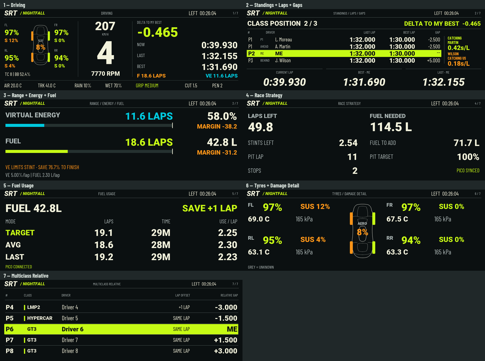

# SRT Dashboard for Le Mans Ultimate

**Nightfall v1.8 is available for both display sizes.**

[Download v1.8](https://github.com/salman-m-sulphi/SRT-Dashboard/releases/tag/v1.8).

- **800 × 480:** `SRT Nightfall v1.8 - 800x480.simhubdash` — four approved pages: Driving; Standings/Laps/Gaps; Strategy/Fuel/Energy; Multiclass Relative.
- **800 × 268 / 2.99-inch Nano:** `SRT Nightfall Nano v1.8 - 800x268.simhubdash` — seven focused pages for readability: Driving; Standings/Laps/Gaps; Range/Energy/Fuel; Race Strategy; Fuel Usage; Tyres/Damage Detail; Multiclass Relative.

Both versions include combined tyre/suspension/overall aero information, track conditions on the driving page, session countdown, page counters, five-second damage alerts, pit/limiter overlays and a minimal live local clock/date waiting screen. Catching messages are retained on the standings page and removed from driving.

The Nano separates dense resource/strategy/usage sections and provides a dedicated tyre/damage detail page with larger readings. The larger version combines strategy, fuel and energy on one page. Both use their correct native canvas sizes. The existing larger v1.8 download is unchanged by this addition.

Import the chosen .simhubdash into SimHub and select it. Enable LMU support. NeoRed LMU plugin is required for suspension/overall aero damage. Optional companion data remains supported but no bridge or firmware is bundled; unavailable telemetry may show N/A. Overall aero damage does not distinguish individual bent wings. Race Control message mirroring is not included.

Validated: native SimHub loading, package integrity, dimensions, page counts/order/counters, shared overlays, bounds, sample-render text overflow and pace/damage regression tests. Calculations are unchanged. Screenshots use sample data; live driving and actual small-screen readability still require user verification.

## Larger screen — 800 × 480

## Nano — 800 × 268 / 2.99 inches

## Earlier releases

Previous versions remain available. The original v1.7 800 × 480 file had an incorrect 268-pixel canvas height; use v1.8 on the larger display. Earlier Nano and white GT Factory releases remain separate.

## Distribution

SimHub dashboard import packages only. No bridge EXE or Pico firmware. All rights reserved; no open-source licence is granted. Import files contain editable dashboard definitions and formulas.
