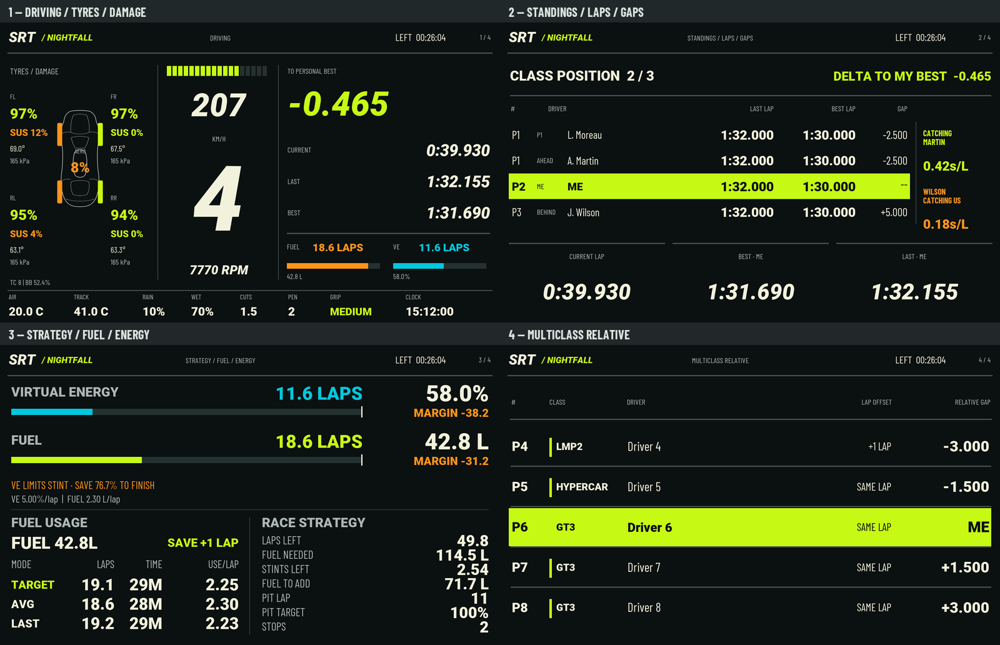
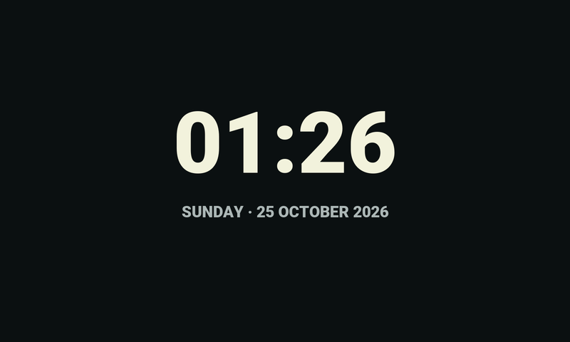
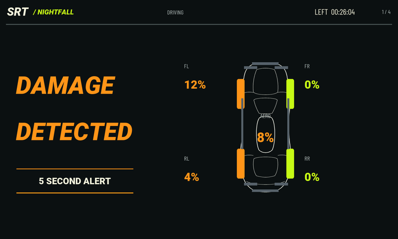
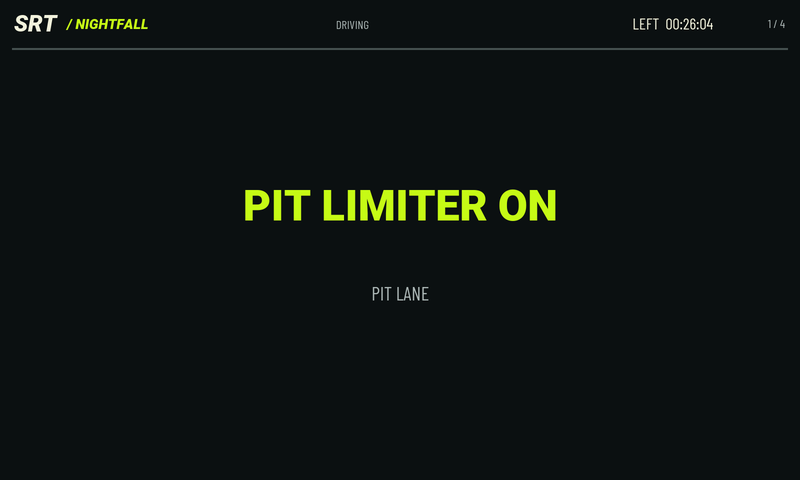

# SRT Dashboard for Le Mans Ultimate

Latest: **Nightfall v1.8 — 800 × 480**, with the approved four-page layout.

[Download v1.8](https://github.com/salman-m-sulphi/SRT-Dashboard/releases/tag/v1.8), or import `dashboards/nightfall/800x480/SRT Nightfall v1.8 - 800x480.simhubdash`.

1. Driving: one tyre/damage diagram, large tyre percentages, suspension damage beside each wheel and overall aero damage in the centre. Track conditions replace the catching messages along the bottom.
2. Standings / Laps / Gaps: leader, ahead, player and behind, personal-best delta and three-lap catching indicators.
3. Strategy / Fuel / Energy: large resource ranges and amounts at the top, fuel usage at bottom left and race strategy at bottom right.
4. Multiclass Relative: five rows across all classes.

Session time and 1–4 page counters remain. Five-second damage alerts, pit/limiter overlays and the minimal live local clock/date waiting screen work across all four pages. Canvas is correctly set to 800 × 480.

Import the attached .simhubdash into SimHub, then select SRT Nightfall v1.8 - 800x480. Enable LMU support. NeoRed LMU plugin is required for suspension/overall aero damage. Optional companion data is supported but not bundled; some fields may show N/A without it. Overall aero damage does not identify separate bent wings. Race Control message mirroring is not included.

Validated: native SimHub loader, packaged canvas dimensions, page order/counters, shared overlays, bounds, normal/pit/damage/waiting and FIN/LRN/N/A sample renders, pace/damage regression checks. Calculations are unchanged; live driving verification is still required. Screenshots use sample data.

v1.8 is for 800 × 480. The 800 × 268 Nano remains at v1.7 in earlier downloads. No bridge EXE or firmware is included.

## Preview

## Earlier versions

[Nightfall v1.7](https://github.com/salman-m-sulphi/SRT-Dashboard/releases/tag/v1.7) remains available in both sizes. Its original 800 × 480 package had a 268-pixel canvas height and clipped the layout; use v1.8 for the larger screen. The Nano 800 × 268 version is unaffected. White GT Factory v1.3.1 dashboards remain available in their existing folders and releases.

## Distribution

Dashboard packages only. All rights reserved; no open-source licence is granted. Import packages contain editable dashboard definitions and formulas.
